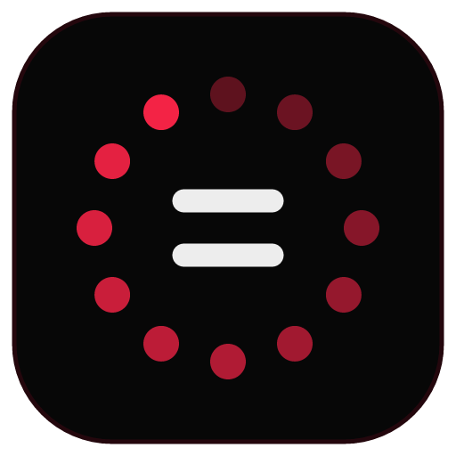
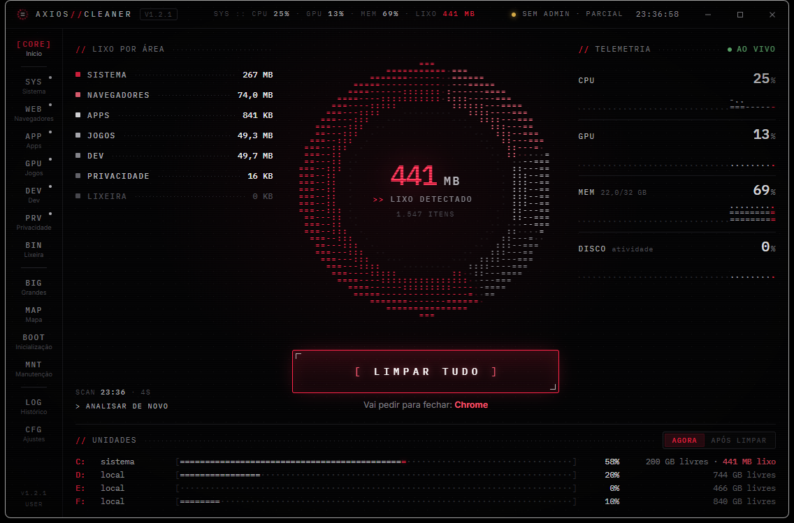
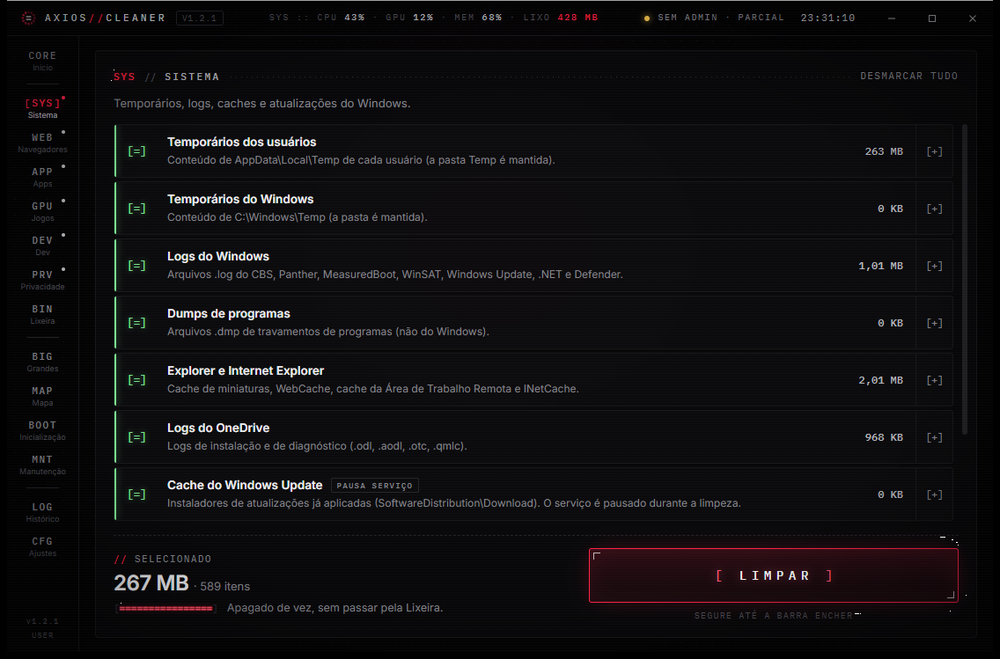
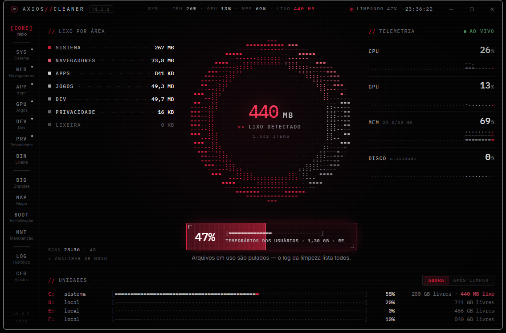
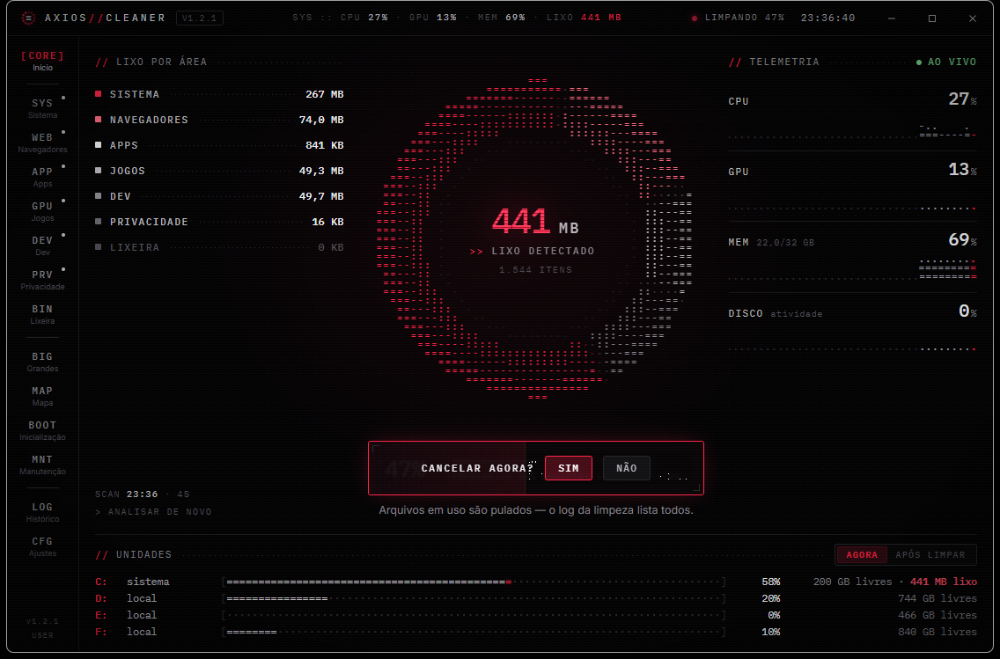
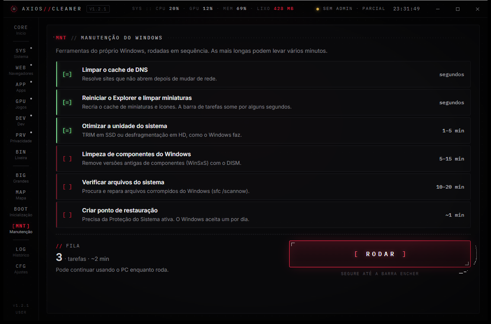
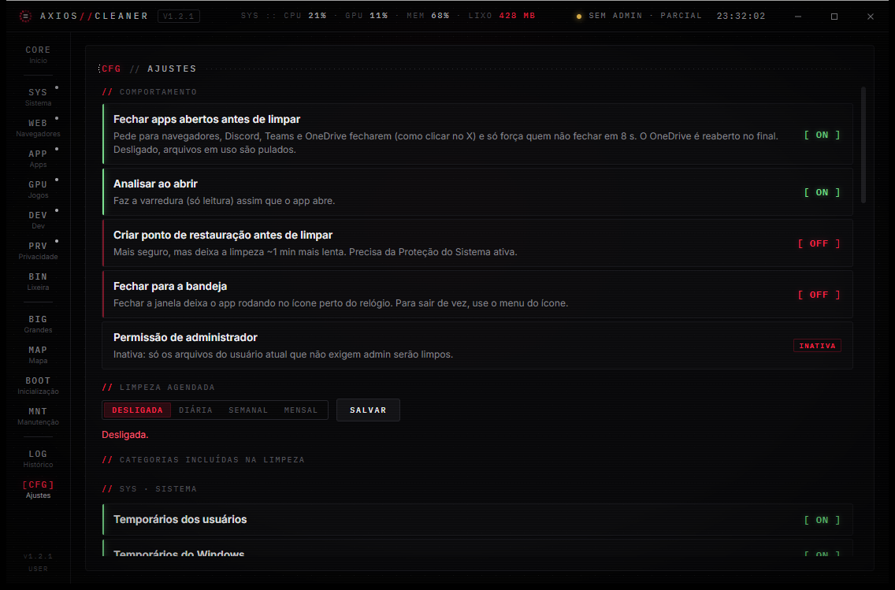
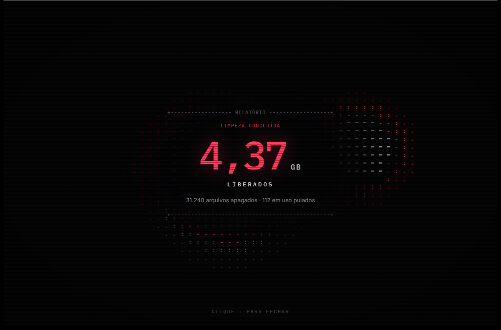

<div align="center">
    
    <h1>Axios Cleaner</h1>
    <b>English</b> · <a href="README.pt-BR.md">Português (Brasil)</a>
</div>

<p align="center">
  Axios Cleaner keeps your Windows PC light, fast and private.<br>
  It sweeps temporary files, caches and logs from <b>Windows</b>, <b>browsers</b>, <b>apps</b>, <b>games</b> and <b>dev tools</b>,<br>
  with a futuristic ASCII interface — <b>no account, no telemetry, nothing about you leaves your machine</b>.
</p>

<p align="center">
  
  
</p>

<p align="center">
  <a href="https://github.com/YuriTals/axios-cleaner/releases/latest"></a>
  
  
  
  
  <a href="LICENSE"></a>
  <a href="https://buymeacoffee.com/axiosdevteam"></a>
  <a href="https://ko-fi.com/axiosdevteam"></a>
</p>

## Highlights

- **34 cleaning categories in 6 areas:** System, Browsers, Apps, Games & GPU, Dev and Privacy. Every category can be turned off, and you can see where the files are and which are the biggest before cleaning.
- **Live progress inside the button:** hold to start; while it runs the button shows the real %, the current step and the time left. Hover to **cancel**, and the button asks for confirmation right inside it.
- **Safe by design:** shortcuts to folders (junctions/symlinks) are never followed, files in use are skipped and listed in the log, and only empty folders are removed. Browsing history, passwords, cookies, bookmarks and documents are never touched.
- **Polite app closing:** browsers, Discord, Teams and OneDrive are asked to close (like clicking X) and are only forced after 8 s. OneDrive reopens when the cleaning ends. Windows Update is paused and resumed automatically.
- **Tools:** large files finder (sends to the Recycle Bin, so it can be undone), ASCII space map per folder or drive, reversible startup programs manager, and Windows maintenance (DNS, Explorer and thumbnail cache, TRIM, DISM, `sfc`, restore point).
- **Scheduled cleaning and tray icon:** daily, weekly or monthly runs with no window and a notification at the end, plus an optional "close to tray".
- **Live telemetry:** CPU, GPU, memory and disk activity as ASCII charts, and every drive as an ASCII bar showing how much is junk.
- **History and logs:** every cleaning saves a plain-text log you can open from the app.
- **Signed updates:** the app tells you when a new version is out and installs it with one hold of a button. It only accepts installers signed with the project key, and the check can be turned off.

<p align="center">
  
  
</p>

<p align="center">
  
  
</p>

<p align="center">
  
</p>

## What it cleans

| Area | Categories |
|---|---|
| **System** | Recycle Bin · users' Temp folders · `C:\Windows\Temp` · Windows logs (CBS, Panther, MeasuredBoot, WinSAT, Windows Update, .NET, Defender) · program crash dumps · Explorer and Internet Explorer caches · OneDrive logs · Windows Update download cache · Delivery Optimization · Windows Error Reporting and minidumps |
| **Browsers** | Microsoft Edge · Google Chrome · Mozilla Firefox · Brave · Vivaldi · Opera / Opera GX — cache only, in every profile |
| **Apps** | Spotify · Adobe Media Cache · VMware · TeamViewer · Discord · Microsoft Teams · Slack · Visual Studio Code · Zoom · Microsoft Store apps |
| **Games & GPU** | Shader caches (DirectX, NVIDIA, AMD, Intel) · Steam · Epic Games Launcher — games and saves stay |
| **Dev** | npm, Yarn and pip · NuGet, Gradle and Go · Cargo (Rust) — downloaded again when needed |
| **Privacy** | Recent files list · taskbar jump lists — the files themselves stay |

> Clearing shader caches is safe, but games rebuild them, so the first few matches may stutter a little. Uncheck that category if you prefer.

## Install

1. Download `AxiosCleaner_<version>_x64-setup.exe` from the [Releases page](https://github.com/YuriTals/axios-cleaner/releases/latest) and run it.
2. Open **Axios Cleaner**. It asks for administrator permission, which it needs to clean Windows folders and every user's Temp folder.

The installer is not code-signed, so Windows SmartScreen may warn you the first time. Click **More info › Run anyway**.

## Requirements

- Windows 10 or 11, 64-bit.
- Microsoft Edge WebView2 Runtime (already included in Windows 11; the installer downloads it on Windows 10 if it is missing).
- Administrator permission to run (requested when the app opens).

## Privacy

Everything happens on your machine. Axios Cleaner has **no account, no telemetry and no analytics**. Its only network connection is the update check: at launch and about every 12 hours it asks GitHub for the latest release of this repository, sending nothing about you. You can turn it off in **Settings › Updates**.

The interface runs on Microsoft's WebView2, which by default contacts Microsoft (automatic sign-in with the Windows account, SmartScreen, remote configuration). The app turns all of that off and points WebView2 at a dead network, so the interface itself cannot reach the internet; the update check runs in the native backend. With the update check off, 90 seconds of monitoring showed **zero external connections** from the app and its WebView2 processes.

Settings, history and logs are saved only in `%APPDATA%\Axios Cleaner`. The full audit, with trust boundaries, findings and evidence, is in [SECURITY.md](SECURITY.md).

## Safety

- Cleaning rules are fixed in [`src-tauri/src/rules.rs`](src-tauri/src/rules.rs): one rule per folder and file mask.
- Target folders reached through a junction or symlink are ignored, and every file is checked again right before it is deleted, so another user cannot redirect the cleaning to `C:\Windows`.
- Commands called by the interface validate everything they receive. "Open" never runs programs, and the Recycle Bin tool only accepts files found by its own search.
- Scheduled cleaning only works when the app is installed in Program Files, because the scheduled task runs as administrator.

## Build

Requirements: [Rust](https://rustup.rs) (MSVC toolchain), [Node.js](https://nodejs.org) and the Visual Studio C++ Build Tools.

```sh
npm install
npm run build        # builds the .exe and the installer (src-tauri/target/release/bundle/nsis)
npm test             # interface tests (node --test) and Rust tests (cargo test)
```

### Publishing an update

1. Bump the version in `src-tauri/tauri.conf.json`, `src-tauri/Cargo.toml`, `package.json` and `ui/js/catalog.js`, then commit and push.
2. Run `npm run release -- notes.md`. It builds the installer signed with the update key (`~/.tauri/axios-cleaner-updater.key`, kept out of the repository), writes `latest.json` and publishes the release to this repository.
3. Installed apps with the update check on will offer the new version.

Development helpers:

- `AXIOS_NO_ELEVATE=1`: builds without the administrator prompt (tests and previews).
- `AXIOS_ROUTE=<screen>`: opens straight on a screen (`home`, `system`, `browsers`, `apps`, `games`, `dev`, `privacy`, `recycle`, `big`, `map`, `startup`, `tasks`, `history`, `settings`). `demo-run`, `demo-hover`, `demo-confirm` and `demo-result` simulate the running button and the result screen.
- `axios-cleaner.exe --auto`: the scheduled cleaning mode.

### Project structure

| Path | Responsibility |
|---|---|
| `src-tauri/src/main.rs` | App setup: plugins, state, window or scheduled mode |
| `src-tauri/src/commands.rs` | Commands called by the interface |
| `src-tauri/src/pipeline.rs` | One cleaning: restore point → close apps → pause services → clean → log |
| `src-tauri/src/engine.rs`, `rules.rs` | Scanning, safe deletion and the rules of each category |
| `src-tauri/src/system.rs` | Windows integration: processes, services, maintenance, scheduling, Explorer |
| `src-tauri/src/shell.rs` | Window, tray icon and scheduled cleaning |
| `src-tauri/src/updates.rs` | Signed updates from this repository's releases |
| `scripts/release.mjs` | Signed build + `latest.json` + GitHub releases |
| `src-tauri/src/files.rs`, `startup.rs`, `perf.rs`, `store.rs` | Large files and space map, startup programs, telemetry, settings and logs |
| `ui/js/` | Interface modules: `state`, `format`, `run` (execution button), `views/*`, `canvas`, `actions`, `render`, `main` |
| `tests/ui/` | Interface tests |

## License

Axios Cleaner is free software under the [GNU Affero General Public License v3.0](LICENSE) (AGPL-3.0). Third-party names and fonts are not covered by it; see the disclaimer below.

## Disclaimer

Axios Cleaner is an independent project and is not affiliated with, endorsed by or sponsored by Microsoft, Google, Mozilla, Brave, Vivaldi, Opera, Valve, Epic Games, NVIDIA, AMD, Intel, Adobe, Discord, Slack, Zoom, Spotify, VMware or TeamViewer. Windows, Edge, OneDrive, Teams, Visual Studio Code and the other product names mentioned are trademarks of their respective owners, with all rights reserved to them. The bundled fonts, IBM Plex Mono and Inter, belong to their authors and are distributed under the SIL Open Font License 1.1, included in [`ui/fonts/licenses/`](ui/fonts/licenses/).

Cleaning deletes files permanently (except the large files tool, which uses the Recycle Bin). Review the selected categories before cleaning; you use the app at your own risk.
